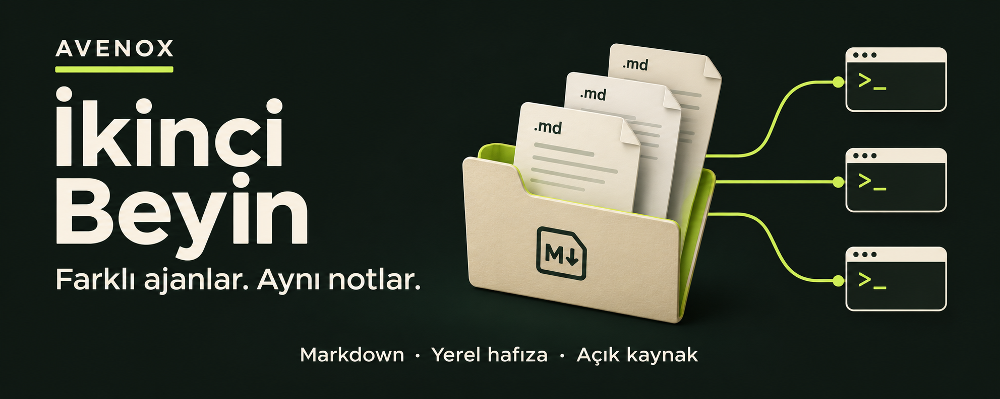
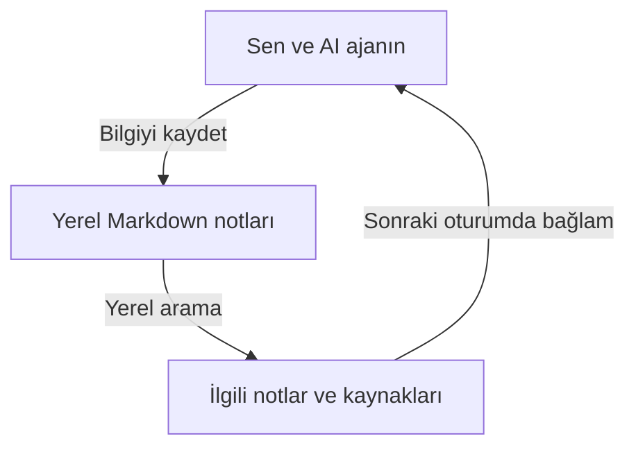
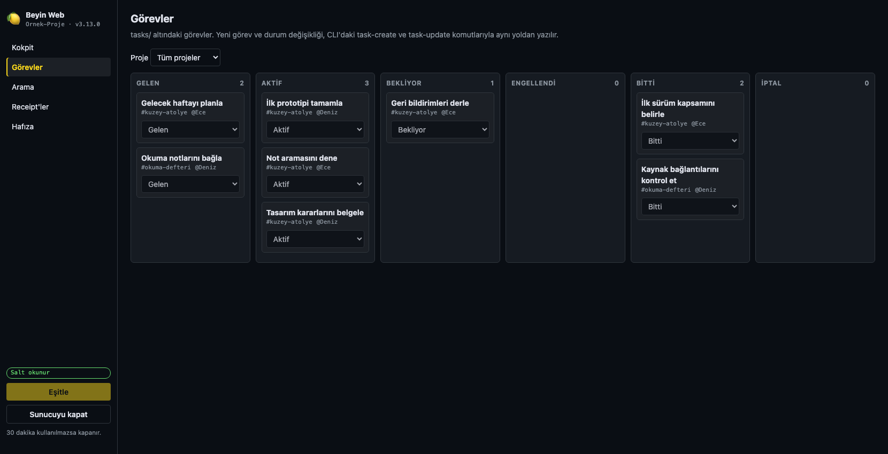

# İkinci Beyin



**AI istemcin değişse de notların, kararların ve görevlerin aynı yerde kalsın.**

AvenoxBeyin, AI ajanlarınla kullanabileceğin yerel bir hafıza sistemi. Önemli bilgiyi Markdown dosyalarına kaydettirir, sonraki oturumda kaynağıyla bulursun. Klasörünü Obsidian'da veya istediğin metin editöründe açabilirsin.

**[Kuruluma geç](#kurulum)** · [Son sürümü indir](https://github.com/avenoxai/avenoxbeyin/releases/latest) · [Görsel kurulum rehberi](https://avenox.io/ikincibeyin) · [Belgeler](#belgeler)

macOS · Windows · Linux &nbsp; | &nbsp; Python 3.11+ &nbsp; | &nbsp; [MIT lisansı](LICENSE)

## Ne işe yarar?

| İstediğin | Beyin ile yapabileceğin |
| --- | --- |
| Yeni oturumda kaldığın yerden devam etmek | Son işin sonucunu, açık konuları ve sonraki adımı kaynak notlara kaydetmek |
| Daha önce verdiğin kararı bulmak | Notlarda aramak, kararın geçtiği dosyayı açmak |
| Bir kaynağı kaybetmemek | Video, makale veya dosyayı **Yakala** ile gelen kutuna almak |
| Claude'dan Codex'e geçmek | Aynı klasördeki not ve görevleri başka bir desteklenen istemciyle kullanmak |

### Nasıl çalışır?



Asıl kaynak dosyaların. Beyin bunların yerel indeksini tutar ve seçilen bağlamı kullandığın AI istemcisine verir. Sohbet geçmişinin tamamını kendiliğinden bilgiye dönüştürmez; kalıcı olmasını istediğin şeyi nota yazdırırsın.

> **V3.13.0'da yeni:** Yakala'dan isteğe bağlı Claude/Codex'e gönderim, Word (.docx) belgelerini okuma, Pi bağlantısı ve OpenCode global köprüsü. Yerel web görünümü ve çalışma alanı araçları da bu sürümde. [Tüm yenilikler](docs/v3/releases/3.13.0.md).

<a id="kurulum"></a>
## Üç adımda kurulum

**Gerekenler:** Python **3.11+** ve desteklenen bir AI istemcisi. İstemcinin kurulumu ve hesabı ayrı gerekir. Beyin'in temel kurulumu için Git, pip, Mem0 hesabı, ek API anahtarı veya sürekli açık sunucu gerekmez. Obsidian isteğe bağlıdır.

### 1. Bir klasör seç

Yeni bir klasör veya mevcut Obsidian vault'un olabilir. Notlarını başka yere taşıman gerekmez.

### 2. AI istemcinde o klasörü aç

Claude Code, Codex veya aşağıdaki [istemcilerden](#istemciler) birini kullan. Kurulumu istediğin klasörde çalıştığından emin ol.

### 3. Bu mesajı yapıştır

```text
https://avenox.io/beyin.md adresini oku. Bu klasöre ikinci beynimi kur.
Mevcut kurulum varsa notlarımı koruyarak güncelle. Gerekli indirme ve
kurulum adımlarını sen yap. Sonunda örnek bir bilgiyi kaydedip yeni
oturumda geri okuyarak birlikte doğrulayalım.
```

Ajan resmi kararlı paketi indirir, checksum'u doğrular ve kurulumu kontrol eder. İstemcinin gösterdiği klasör veya hook güven incelemesini tamamla. Ardından **aynı klasörde yeni bir oturum aç**; Codex'te yeni hook tanımlarını `/hooks` ekranında incele.

<details>
<summary><strong>Terminalden kendim kurmak istiyorum</strong></summary>

1. [Son sürümden](https://github.com/avenoxai/avenoxbeyin/releases/latest) **`beyin-v3-X.Y.Z.zip`** ve yanındaki **`.sha256`** dosyasını indir. GitHub'ın **Source code** arşivini seçme.
2. ZIP'in SHA-256 değerini yanındaki dosyayla karşılaştır ve paketi aç. [Doğrulama adımları](beyin.md).
3. **Açtığın paket klasöründe** terminal aç. Vault yolunu kendi not klasörünle değiştir:

**macOS / Linux**

```sh
python3 scripts/install_v3.py --vault "/tam/yol/Beynim"
```

**Windows**

```powershell
py -3 scripts/install_v3.py --vault "C:\Notlar\Beynim"
```

Kurucu motoru, istemci bağlantılarını ve dört başlangıç skill'ini vault'a yerleştirir. Paket klasörünü açık tutman gerekmez. Vault'u istemcinde aç, güven incelemesini tamamla ve yeni bir oturum başlat. [Ayrıntılı kurulum](SETUP-V3.md).

</details>

## İlk 5 dakika

Ajanına sırayla şunları söyle. Bunlar örnek mesajlar; kendi bilgilerinle değiştirebilirsin.

| Adım | Ajanına söyle |
| --- | --- |
| **Tanış** | “Beyin skill'ini kullan. Beni tanımak için birkaç kısa soru sor ve cevaplarımı notlara kaydet.” |
| **Kaydet** | “Örnek proje için Python seçtim, çünkü ekip Python biliyor. Bunu karar notu olarak kaydet.” |
| **Geri bul** | Yeni oturum aç: “Örnek projede hangi dili seçmiştik, neden? Kaynak notu göster.” |
| **Görev oluştur** | “Örnek projenin ilk taslağını hazırlamam için bir görev oluştur.” |

Kaydı dosyada, geri çağırmayı yeni oturumda kontrol et. Böylece kendi istemcinde bağlantının çalıştığını da görürsün.

<details>
<summary><strong>Kurulan dört skill ne yapıyor?</strong></summary>

| Skill | Kullanım |
| --- | --- |
| **beyin** | Not bulma, bilgi kaydetme, görev ve iş sonucu oluşturma |
| **beyin-doktor** | Bağlantı, kayıt ve kurulum sorunlarını kontrol etme |
| **beyin-guncelle** | Güncelleme, sürüm kontrolü ve geri alma |
| **beyin-kontrol** | Hafızadaki bilginin hala doğru olup olmadığını denetleme; yalnız sen istediğinde çalışır, onayın olmadan yazmaz |

Ortak kaynak `.agents/skills` içindedir; Claude ve Kiro kendi proje kopyalarını kullanır. Mevcut kişisel skill'ler sessizce ezilmez.

</details>

<a id="istemciler"></a>
## Hangi istemcilerle kullanılır?

| İstemci | Kurulum sonrası |
| --- | --- |
| **Claude Code** | Vault klasöründe yeni oturum aç. |
| **Codex** | Yeni hook tanımlarını `/hooks` ile incele; yeni oturum aç. |
| **Google Antigravity** | Vault'u workspace olarak aç ve klasöre güven. [Kurulum](SETUP-V3.md) |
| **Kiro** | Hook'ları incele; yeni oturum aç. [Rehber](docs/v3/KIRO.md) |
| **Hermes Agent** | Profil bağlantısını yap, `beyin-v3` eklentisini etkinleştir. [Rehber](docs/v3/HERMES.md) |
| **OpenCode** | Vault klasöründe aç; eklenti yüklenir. [Rehber](docs/v3/OPENCODE.md) |
| **OMP / Oh My Pi** | Vault klasöründe aç; hook yüklenir. [Rehber](docs/v3/OMP.md) |
| **Pi** | Extension için proje güvenini onayla; yeni oturum aç. [Rehber](docs/v3/PI.md) |
| **DeepSeek Harness (DSH)** | Vault klasöründe aç; skill'ler `.agents/skills` altından yüklenir, hook yok. [Rehber](docs/v3/DSH.md) |

İstemcilerin hook ve güven akışları farklıdır. Codex Desktop'ta açık skill kullanımı ile otomatik hook teslimi aynı şey değildir; otomatik Desktop akışı henüz doğrulanmış sayılmaz. [Gerçek istemci kontrolleri](docs/v3/LIVE-CLIENTS.md).

Başka proje klasörlerinde çalışırken merkezi beynine erişmek için [isteğe bağlı global köprü](docs/v3/GLOBAL-BRIDGE.md) var.

## Bir kaynağı tek tuşla yakala

Video, tweet, makale, mail veya dosyayı gelen kutuna al. Sonra ajanına **“yakalananları işle”** de; metni çıkarıp notlarına bağlasın.

**Bir kez, vault klasöründe:**

```sh
python3 beyin.py yakala kur
```

| macOS | Windows | Linux |
| --- | --- | --- |
| `Control + Option + B` | `Ctrl + Alt + B` | KDE Plasma'da `Ctrl + Alt + B`; diğer masaüstleri için [rehber](docs/v3/YAKALA.md) |

Varsayılan **Enter** yalnız kartı kaydeder. İstersen Claude Code veya Codex ajan modunu ayrıca açıp **Ctrl+Enter** ile o kartı ajana gönderebilirsin. Word (.docx) belgeleri desteklenir; YouTube sesini yazıya çevirme gibi ek işler ayrı araçlar gerektirebilir. [Yakala rehberi](docs/v3/YAKALA.md).

## Beynine tarayıcıdan bak

Görevlerini, son iş sonuçlarını ve doktor özetini tek ekranda gör. İsteğe bağlı web görünümünü **vault klasöründe** aç:

```sh
python3 beyin.py web ac
```



*Gerçek arayüz, örnek not ve görevlerle, salt okunur modda görüntülendi. Kişisel veri içermez.*

Yalnız bu bilgisayarda açılır; 30 dakika kullanılmazsa kapanır. Kurulum sırasında kendiliğinden başlamaz. Sadece görüntülemek için `web ac --read-only` kullan. [Web rehberi](docs/v3/WEB.md).

## Güncelleme ve yardım

Güncellemek için ajanına **“beynimi güncelle”**, sorun varsa **“beyin-doktor ile kontrol et”** de. Terminal tercih edersen **vault klasöründe**:

```sh
python3 beyin.py update --check   # Yeni sürümü kontrol et
python3 beyin.py update          # Güncelle
python3 beyin.py doctor          # Kurulumu ve bağlantıları kontrol et
```

**Windows:** Bu sayfadaki `python3 beyin.py ...` komutlarında `python3` yerine `py -3` kullan.

**Yakala kullanıyorsan**, güncellemeden sonra `python3 beyin.py yakala kur` komutunu bir kez daha çalıştır; ayrı kopyalanan dinleyici ve skill de yenilensin. İstemcinde yeni oturum aç. Global köprü kullanıyorsan sürümün [yeniden kurulum notlarını](docs/v3/releases/3.13.0.md) da kontrol et.

Kullanıcı notları güncellenen sistem dosyalarından ayrıdır. Yönetilen bir dosyada kendi değişikliğin varsa sessizce ezilmez; çakışma bildirilir. [Çevrimdışı güncelleme, `rollback` ve `recover`](docs/v3/UPDATE.md).

## Merak edilenler

<details>
<summary><strong>Notlarım nerede? AI sağlayıcısına ne gider?</strong></summary>

Notların yerel Markdown dosyalarında, indeks bu bilgisayarda tutulur. Seçilen bağlam AI istemcine verilir; istemcinin model sağlayıcısı ve hesap koşulları geçerlidir. “Yerel hafıza”, bütün AI konuşmasının çevrimdışı olduğu anlamına gelmez.

Özel not işaretleri Beyin'in bağlam ve web filtrelerini etkiler; dosya erişimi verdiğin bir ajan için işletim sistemi düzeyinde koruma oluşturmaz. [Kaynak biçimi ve görünürlük](docs/v3/MARKDOWN.md).

</details>

<details>
<summary><strong>Ek maliyet veya sürekli çalışan bir servis var mı?</strong></summary>

Temel yerel kontroller model çağırmaz. Ajana yaptırdığın işler ve eklenen bağlam istemcinin normal tüketimine girer. “Ekonomik moda geç” veya “otomatik kontrolleri kapat” diyebilirsin; desteklenen istemciler aynı vault tercihini kullanır.

İstemciler kapalıyken sürekli hafıza tarayan bir servis yoktur. Yakala dinleyicisi ve web görünümü ayrı, isteğe bağlı araçlardır. Sürüm bildirimi günde en fazla bir kez GitHub'ı kontrol eder; not göndermez ve kendiliğinden güncelleme kurmaz. İsteğe bağlı Jev danışmanı varsayılan kapalıdır.

[Normal / Ekonomik / Manuel modlar](docs/v3/PREFERENCES.md) · [Jev](docs/v3/JEV.md)

</details>

<details>
<summary><strong>Her şeyi hatırlar mı? Eski sohbetlerim ne olur?</strong></summary>

Arama yerel kelime eşleştirmesine dayanır; her soruda doğru hatırlama garantisi yoktur. Önemli kararları nota yazdır, gerektiğinde kaynağını açtır. İş sonucu kaydı da ajanın yazdığı bir iddiadır; bağımsız doğrulama yerine geçmez.

Eski sohbet geçmişinin tamamı otomatik alınmaz. İsteğe bağlı sohbet izi ve geçmişten özet çıkarma için [chat-trace rehberi](docs/v3/CHAT-TRACE.md), son işlerin özeti için [komut rehberi](docs/v3/QUICKSTART.md) var.

</details>

<details>
<summary><strong>V2'den geliyorum veya vault'u başka bilgisayara taşıyorum</strong></summary>

V2'den geçişte aynı kurucuyu mevcut vault üzerinde çalıştırırsın. Notlar ve eski günlükler korunur; tanınan eski otomatik yazıcılar geri alınabilir biçimde devreden çıkarılır. Özelleştirilmiş dosyalar varsa kurucu durup açıklar. V2'nin arka planda model çağıran derleyicisi V3'te çalışmaz.

Vault'u taşımak ve birden çok makinede kullanmak ayrı adımlar gerektirir; çalışma veritabanını sıradan bir eşitlenen dosya gibi paylaşma.

[V2 geçişi](docs/v3/MIGRATION.md) · [Birden çok makine](docs/v3/MULTI-MACHINE.md) · [Tarihsel V2 rehberi](docs/V2-README.md)

</details>

<a id="belgeler"></a>
## Belgeler ve katkı

| Aradığın | Rehber |
| --- | --- |
| Komutlar, görevler ve son işlerin özeti | [Komut rehberi](docs/v3/QUICKSTART.md) |
| Açılış hafızası, kişilik ve arşivleme | [Companion](docs/v3/COMPANION-PARITY.md) |
| Çalışma alanları ve not bağlantıları | [V3.13.0 yenilikleri](docs/v3/releases/3.13.0.md) |
| Teknik mimari ve kaynak biçimi | [V3 belgeleri](docs/v3/README.md) · [Runtime](docs/v3/RUNTIME.md) · [Markdown](docs/v3/MARKDOWN.md) |
| Neler test edildi? | [Platform testleri](docs/v3/PLATFORM-TESTS.md) · [Gerçek istemciler](docs/v3/LIVE-CLIENTS.md) |
| Bir hata veya katkı | [Issue aç](https://github.com/avenoxai/avenoxbeyin/issues) · [Katkı rehberi](CONTRIBUTING.md) |

Avenox'un günlük ikinci beyin iş akışlarından geliştirildi. Katkı veren herkese teşekkürler. V2 bilgi derleme fikri için [Karpathy'nin bilgi tabanı deseninden](https://gist.github.com/karpathy/442a6bf555914893e9891c11519de94f) yararlanıldı.
