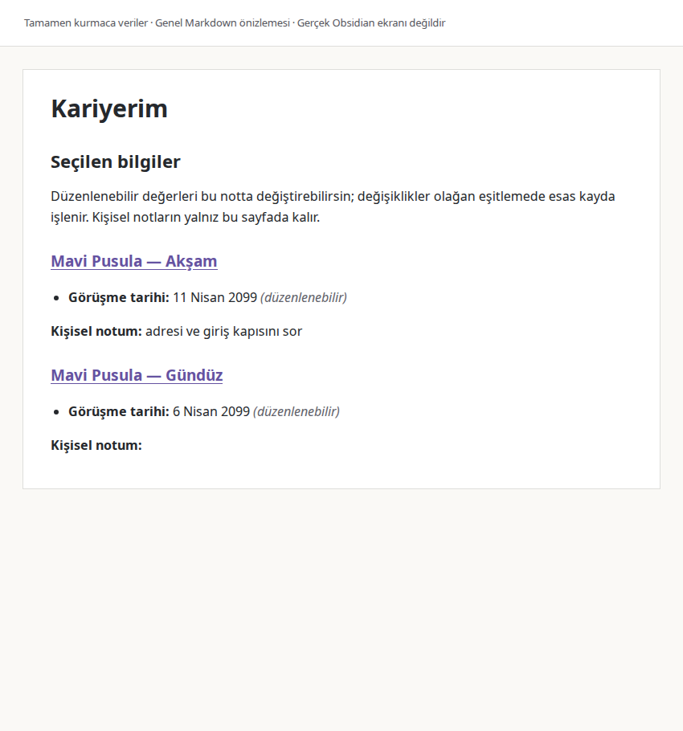
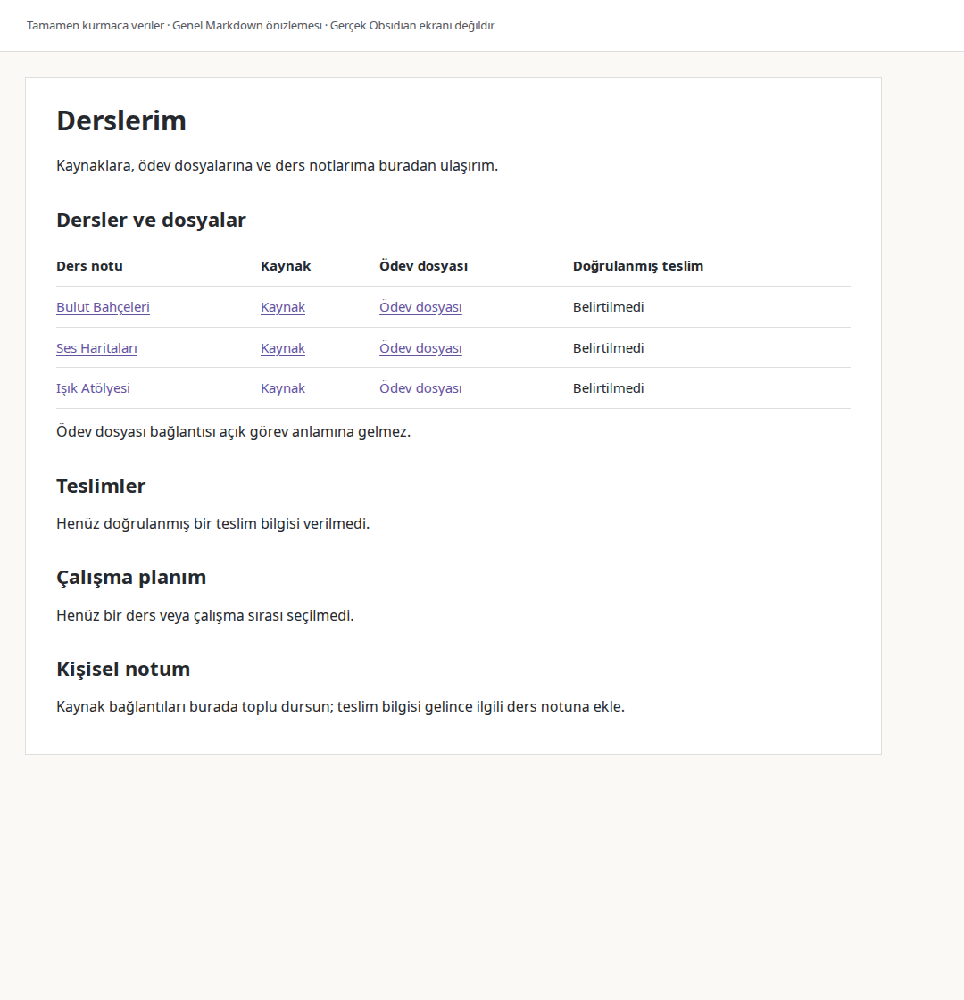

# Workspace ana sayfaları: kurmaca kullanım örnekleri

Bu örneklerdeki Mavi Pusula görüşmeleri, dersler, tarihler ve dosyalar tümüyle
uydurmadır. Betik geçici bir kasaya v3 paketini kurar, herkese açık CLI
komutlarıyla örnekleri oluşturur ve sonuçları denetler. Gerçek bir kullanıcı
kasasına dokunmaz.

Depo kökünden çalıştır:

```sh
python3 scripts/example_workspace_homepages.py --output /tmp/workspace-homepage-examples
```

Windows'ta `--output` için kendi geçici klasöründen bir yol seçebilirsin.
Komut, kontrol sonucunu ekrana ve `result.json` dosyasına yazar. Aynı çıktı
klasöründeki Markdown dosyaları akışın okunabilir anlık görünümleridir;
bağlama ait HTML yorumları bu kopyalardan çıkarılmıştır. `vault/` altındaki
kurmaca not ve kaynak kopyalarıyla birlikte taşınabilirler. Görünümdeki
bağlantılar, akışın **son durumundaki** bu dosyalara gider; geçmiş bir adımın
kaynak içeriğini yeniden kurmaz. Betik özgün bağlantıları geçici kasada,
dışa aktarılan bağlantıları çıktı klasöründe doğrular. Geçici kurulu çalışma
ortamı dışa aktarılmaz.

## Kariyerim: seçilmiş bilgiyi iki yönde düzenleme

Kurmaca Mavi Pusula'nın **Akşam** ve **Gündüz** kayıtları ayrı esas notlardır.
Her ikisi de önce **6 Nisan 2099** görüşme tarihini taşır; davet metni ayrı
bir özgün dosyadır. `homepage-create`, kullanıcının seçtiği `facts.gorusme`
alanlarını **Kariyerim** sayfasına bağlar. Her kaydın bağlantısı ana sayfaya
göre görelidir. Görüşme tarihi düzenlenebilir hücrede, kişisel not hücrenin
dışındadır.

Örnek kullanıcı isteği: “İki görüşmenin tarihini tek sayfada görmek ve oradan
düzeltmek istiyorum. Akşam kaydının yanına da yol süresiyle ilgili not yazayım.”
Bu cümle açıklayıcı bir kullanım taslağıdır; otomatik bir ajan konuşmasının
çalıştırıldığı iddia edilmez.

Başlangıçta iki ayrı esas not vardır:

| Esas not | Başlık | `facts.gorusme` | Özgün belge |
| --- | --- | --- | --- |
| `notes/Kariyer/Aksam.md` | Mavi Pusula — Akşam | 6 Nisan 2099 | `Davet.txt` |
| `notes/Kariyer/Gunduz.md` | Mavi Pusula — Gündüz | 6 Nisan 2099 | `Davet.txt` |

Betik bunları normal `note-create` ile oluşturur. Ardından şu isteği
`homepage-create --file` girişine verir; değer veya hücre işareti hazırlamaz:

```json
{
  "source": "notes/Kariyer/Ana Sayfa.md",
  "expected_sha256": null,
  "title": "Kariyerim",
  "project": "kariyer",
  "selections": [
    {"source": "notes/Kariyer/Aksam.md", "fields": [
      {"field": "facts.gorusme", "label": "Görüşme tarihi", "editable": true}
    ]},
    {"source": "notes/Kariyer/Gunduz.md", "fields": [
      {"field": "facts.gorusme", "label": "Görüşme tarihi", "editable": true}
    ]}
  ]
}
```

Oluşan sayfada kullanıcı iki ayrı kaynak bağlantısı ve iki düzenlenebilir
tarih görür. Normal `note-edit` ile eklenen “yol süresini ve adresi sor” notu
yalnız Akşam bölümünde kalır; esas notun `facts` alanına yazılmaz.



*Kariyerim: üretilen Markdown'ın genel önizlemesi; gerçek Obsidian ekran görüntüsü değildir.*

Örnek akışı şu anlık görünümlerden izle:

| İşlem ve anlık görünüm | Akşam esas notu | Akşam sayfa değeri | Gündüz | Kişisel not |
| --- | --- | --- | --- | --- |
| [Oluştur](career-created.md) | 6 Nisan | 6 Nisan | 6 Nisan | yol süresini ve adresi sor |
| [Esas notu düzenle](career-from-source.md) | 7 Nisan | 7 Nisan | 6 Nisan | korunur |
| [Sayfadaki tarihi düzenle](career-from-homepage.md) | 9 Nisan | 9 Nisan | 6 Nisan | korunur |
| [Kaynak yazımından sonra kes, son notu değiştir, eşitle](career-recovered.md) | 11 Nisan | 11 Nisan | 6 Nisan | adresi ve giriş kapısını sor |
| [Aynı bilgiye iki farklı değer yaz](career-conflict.md) | 12 Nisan | 13 Nisan — çakışma | 8 Nisan'a ilerler | son not korunur |
| [Kullanıcı esas nottaki değeri seçer](career-resolved.md) | 12 Nisan | 12 Nisan | 8 Nisan | son not korunur |

Tablodaki bütün tarihler 2099 yılındadır. Örneğin esas nottan gelen ilk
değişiklik sonrası Akşam bölümünün okuma görünümü şöyledir:

```markdown
### Mavi Pusula — Akşam

- **Görüşme tarihi:** 7 Nisan 2099 _(düzenlenebilir)_

**Kişisel notum:** yol süresini ve adresi sor
```

Gerçek çıktıda alt başlık [doğru esas nota](vault/notes/Kariyer/Aksam.md)
açılır. Gündüz'ün ayrı dosyası ve özgün davet ilk iki değişiklikte aynı kalır.

Kaynak nottaki düzenleme sayfaya, sayfadaki düzenlenebilir hücre ise doğru
kaynak nota geçer. Diğer kayıt ve özgün davet dosyası korunur. Betik, kaynak
yazıldıktan sonra eşitlemeyi yalnız örnek amaçlı bir kancayla keser. Sonraki
`sync`, kaynağı yeniden yazmadan sayfayı tamamlar; arada güncellenen en son
kişisel notu korur. Betik tam bu ilk toparlanmanın öncesi/sonrasında esas
notun baytlarını ve sabitlenmiş mtime'ını karşılaştırır; aynı baytların tekrar
yazılması da testi bozar. Gerçek ürünün bir kesinti kancası yoktur.

Kesinti adımında önce sayfadaki 9 Nisan değeri 11 Nisan yapılır. Esas not 11
Nisan olarak yazıldıktan, sayfanın eşitleme kaydı tamamlanmadan süreç
durdurulur. Kullanıcı o sırada kişisel notunu “adresi ve giriş kapısını sor”
yapar. Sonraki `sync` hem 11 Nisan'ı hem bu son notu koruyarak işi tamamlar.

Akşam tarihi esas notta **12 Nisan**, sayfada **13 Nisan** yapılınca çakışma
yalnız bu alan için bildirilir. Gündüz tarihi aynı eşitlemede **8 Nisan** olur.
Örnek, Akşam hücresine kaynak değeri olan **12 Nisan** yazıp tekrar eşitler.
Değişmeyen Markdown üzerinde tekrar `sync` çalıştırmak hem dosya baytlarını
hem de değiştirilme zamanını korur.

Bu son kontrol `homepage-create` tekrarını da içerir: aynı seçim `unchanged`
döner ve kişisel sayfa düzenini yeniden yazmaz. Anahtarlı `note-edit`
tekrarı, son hash ve gerçek kullanıcı düzenlemesi için ayrı
[regresyon testleri](../../WORKSPACE-HOMEPAGES.md#regresyon-doğrulaması-ve-açık-kabul-sınırları)
bulunur; bu örnekteki yazmasız `sync` kabulü o ayrı kontrolün yerine geçmez.

## Derslerim: genel gezinme sayfası

**Bulut Bahçeleri**, **Ses Haritaları** ve **Işık Atölyesi** için uydurma ders
notları, kaynak metinleri ve çalışma dosyaları oluşturulur. Genel sayfa ders
notlarına, özgün kaynaklara ve ödev dosyalarına göreli bağlantılar verir.
Bir dosyanın varlığı açık görev veya teslim yükümlülüğü anlamına gelmez.

Örnek kullanıcı isteği: “Bütün kaynaklarımı ve ödev dosyalarımı genel bir
sayfadan açabileyim. Teslim bilgisi, plan ve kişisel not için de yer olsun.”
Bu amaç belirli bir ders seçilmesini veya tarih üretilmesini gerektirmez.

| Kurmaca ders notu | Özgün kaynak | Ödev/çalışma dosyası |
| --- | --- | --- |
| [Bulut Bahçeleri](vault/notes/Dersler/Bulut-Bahceleri.md) | [Kaynak.txt](vault/sources/Ornek-Dersler/Bulut-Bahceleri/Kaynak.txt) | [Calisma-Dosyasi.txt](vault/sources/Ornek-Dersler/Bulut-Bahceleri/Calisma-Dosyasi.txt) |
| [Ses Haritaları](vault/notes/Dersler/Ses-Haritalari.md) | [Kaynak.txt](vault/sources/Ornek-Dersler/Ses-Haritalari/Kaynak.txt) | [Calisma-Dosyasi.txt](vault/sources/Ornek-Dersler/Ses-Haritalari/Calisma-Dosyasi.txt) |
| [Işık Atölyesi](vault/notes/Dersler/Isik-Atolyesi.md) | [Kaynak.txt](vault/sources/Ornek-Dersler/Isik-Atolyesi/Kaynak.txt) | [Calisma-Dosyasi.txt](vault/sources/Ornek-Dersler/Isik-Atolyesi/Calisma-Dosyasi.txt) |

Normal not yazıcısı bir genel sayfa ve üç ders notu oluşturur. Genel sayfadan
hem ders notuna hem özgün dosyalara ulaşılır; ders notunda ise kaynak ve
ödev dosyası ayrı başlıklarda görünür. Kaynakların asılları yerinde kalır.



*Derslerim: üretilen Markdown'ın genel önizlemesi; gerçek Obsidian ekran görüntüsü değildir.*

[lessons-homepage.md](lessons-homepage.md) genel gezinme sayfasını,
[lessons-course.md](lessons-course.md) Bulut Bahçeleri notunu gösterir. Bu
örnek normal `note-create` ve `note-edit` akışını kullanır. Doğrulanmış teslim
tarihi, ilerleme veya seçilmiş çalışma sırası olmadığı için bunları üretmez;
kişisel not yalnız verilen metinle güncellenir. Özgün dosyalar korunur.

Genel sayfanın dosya bağlantılarından sonraki gerçek çıktısı:

```markdown
## Teslimler

Henüz doğrulanmış bir teslim bilgisi verilmedi.

## Çalışma planım

Henüz bir ders veya çalışma sırası seçilmedi.

## Kişisel notum

Kaynak bağlantıları burada toplu dursun; teslim bilgisi gelince ilgili ders notuna ekle.
```

Son kişisel not, ilk “Kaynak bağlantıları burada toplu dursun.” cümlesinin
normal `note-edit` ile düzenlenmesiyle oluşur. Ardından `sync` ve yazmasız
tekrar denetlenir. Hiç görev oluşturulmaz, teslim tarihi atanmaz, belirli bir
ders seçilmez ve ilerleme hesaplanmaz. `facts` veya bağlı hücre bulunmadığı
için bu gezinme sayfasına kaynaktan otomatik değer güncellemesi iddia edilmez.

## İstek örneği

Aşağıdaki konuşma **yalnızca açıklayıcı bir taslaktır**; betik bir ajanın
kullanıcıyla konuşmayı yorumlayıp işlem yaptığı uçtan uca sınama değildir.

> **Kullanıcı niyeti:** “Akşam ve Gündüz görüşmelerimin tarihlerini Kariyerim
> sayfasında göreyim ve oradan düzeltebileyim. Kendi notumu da ekleyeyim.”
>
> **Önerilen taslak:** “İki mevcut kaydın görüşme tarihi alanını sayfaya
> bağlayayım. Tarihleri esas notlarla eşitleyeyim; kişisel notunu sayfada
> tutayım.”

Kurulumun kapsamı ve `homepage-create` istek biçimi için
[özellik belgesine](../../WORKSPACE-HOMEPAGES.md) bak.
